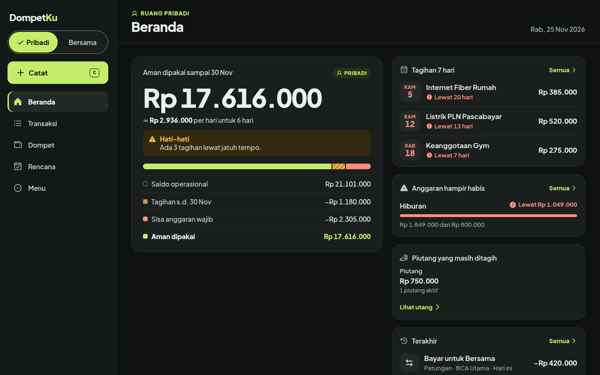
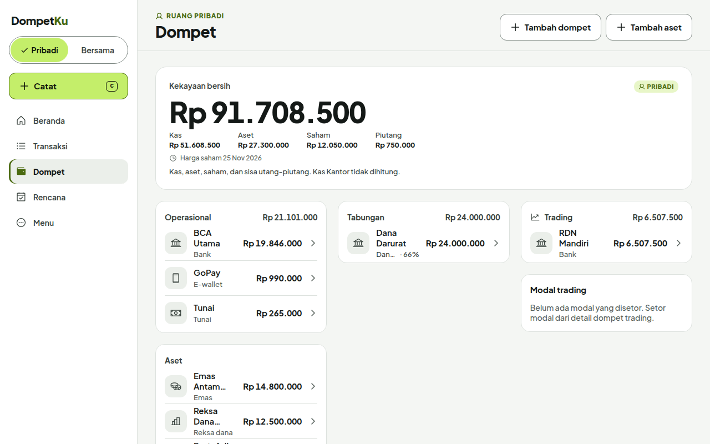
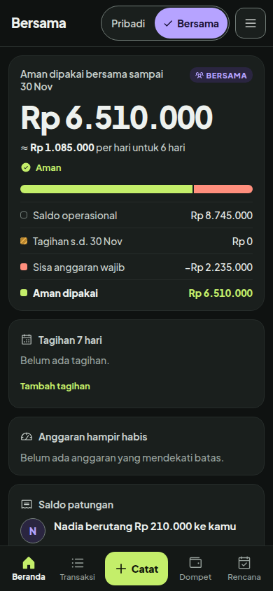
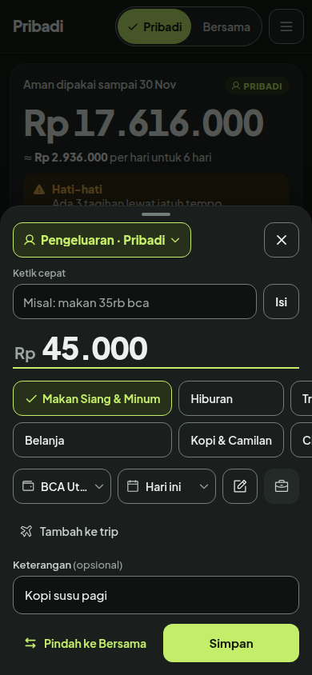
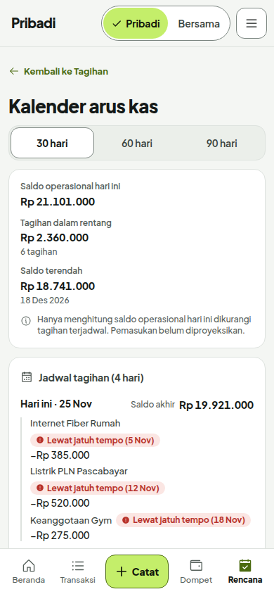

# DompetKu v2

Aplikasi pencatatan dan perencanaan keuangan pribadi + bersama untuk dua orang, **self-hosted**, dibangun di atas double-entry ledger PostgreSQL dengan isolasi ruang ketat (RLS `FORCE`), autentikasi dua faktor wajib, dan antarmuka **Panel Malam** (gelap & terang).

> **Privasi portofolio:** Seluruh tangkapan layar di repo ini dihasilkan secara otomatis dari **data demo 100% fiktif** (Raka & Nadia) lewat Playwright (`pnpm e2e:portfolio`), tidak pernah dari data produksi.

## Pratinjau Portofolio

| Beranda Pribadi (1280 · Gelap)                                                        | Dompet & Kekayaan Bersih (1280 · Terang)                                                |
| ------------------------------------------------------------------------------------- | --------------------------------------------------------------------------------------- |
|  |  |

| Beranda Bersama (390 · Gelap)                                                         | Sheet Catat Cepat (390 · Gelap)                                               | Kalender Arus Kas (390 · Terang)                                                           |
| ------------------------------------------------------------------------------------- | ----------------------------------------------------------------------------- | ------------------------------------------------------------------------------------------ |
|  |  |  |

Lihat seluruh 40 tangkapan layar (10 layar × 390 & 1280 × gelap & terang) di [`docs/screenshots/portfolio/README.md`](docs/screenshots/portfolio/README.md).

## Fitur Utama

- **Dua ruang terisolasi (`Pribadi` & `Bersama`):** Pengalih ruang di header, transfer lintas ruang atomik (`space_transfer`), feed aktivitas Bersama, ringkasan kontribusi per anggota, dan bagi tagihan (Patungan) dengan saldo nol-jumlah dari SQL.
- **Double-entry ledger di PostgreSQL (`bigint`):** Seluruh perhitungan saldo, sisa utang, anggaran, laporan, dan kekayaan bersih dihitung di SQL lewat fungsi `api.*` dengan RLS `ENABLE+FORCE`, kunci idempotensi (`client_id`), riwayat edit (`entry_history`), dan Sampah (retensi 90 hari).
- **Catat cepat & Catat AI hibrida:** Parser nominal lokal (`35rb`, `1,5jt`), saran kategori otomatis, serta input teks bebas hibrida (`LlmProvider` mendukung **Gemini** & **Claude** dengan failover dan kuota harian DB; pratinjau wajib dikonfirmasi sebelum tersimpan).
- **Catat lewat WhatsApp (opsional):** Integrasi OpenWA terisolasi di balik sidecar `wa-proxy` (Caddy allowlist L7, verifikasi HMAC byte mentah, parser aturan ketat tanpa AI).
- **Dompet, Aset, Saham, & Kekayaan Bersih:** Dompet operasional, tabungan, kantor/talangan + reimburse, modal trading, aset non-kas (valuasi), portofolio saham IDX dengan harga di server, dan snapshot kekayaan bersih harian.
- **Rencana, Laporan, & Kalender:** Periode gajian kustom + hari libur, anggaran induk & subkategori, tagihan rutin & deteksi langganan, kalender arus kas 30/60/90 hari, utang/piutang + cicilan, tujuan tabungan, Trip, ekspor **CSV** dan **PDF** (penyusun PDF murni tanpa pustaka eksternal).
- **Analisis AI, Foto Struk Terenkripsi, & PWA Offline:** Analisis bulanan dari agregat SQL saja (tanpa PII/catatan transaksi), lampiran foto struk terenkripsi **AES-256-GCM** (validasi magic bytes, tanpa OCR), dan PWA mode baca offline dengan pembersihan cache wajib saat logout.
- **Keamanan & Operasi:** Better Auth (passkey WebAuthn / kata sandi + TOTP, kode pemulihan, undangan sekali pakai, batas keras 2 akun), audit log append-only, worker `pg-boss` (`dq_reconcile`, `materialize_bills`, `net_worth_snapshot`, `purge_voided`), backup WAL-G terenkripsi + uji restore mingguan, serta deploy pull-based bertanda tangan **cosign**.

## Arsitektur & Teknologi

- **Web:** Next.js 16 (App Router, standalone), React 19, TypeScript strict, Tailwind CSS v4, Radix UI, Zod
- **Database:** PostgreSQL 17, migrasi `dbmate` maju-saja, pengujian basis data `pgTAP` (`pg_prove`)
- **Worker:** Node.js 24 LTS + `pg-boss` (dibundel tunggal dengan esbuild)
- **Pengujian:** Vitest (unit & integrasi Postgres), Playwright (e2e prototipe, auth, ledger, bersama, portofolio, axe WCAG, budget JS ≤ 162 kB/rute), pgTAP
- **Keamanan CI:** `gitleaks`, `Semgrep`, `osv-scanner`, `Trivy`, `shellcheck`, `actionlint`

## Prasyarat

- Node.js 24 LTS (`.nvmrc`; lokal minimal 22.12)
- `pnpm` 10 (`corepack enable`)
- PostgreSQL 16/17 lokal (khusus untuk `test:int`, `e2e:auth`, `e2e:ledger`, `e2e:bersama`, `e2e:portfolio`, dan `pg_prove`)

## Perintah Utama

```sh
pnpm install
pnpm check                                # lint + typecheck + unit test + test:registry + format:check
pnpm build                                # build produksi web & worker
pnpm e2e                                  # e2e prototipe (butuh `pnpm build` lebih dulu)
pnpm --filter @dompetku/web dev           # server pengembangan
```

### Prototipe data demo (tanpa DB)

```sh
NEXT_PUBLIC_PROTOTYPE=1 pnpm build
NEXT_PUBLIC_PROTOTYPE=1 pnpm --filter @dompetku/web start
```

Buka `http://localhost:3000`.

### Pengujian dengan PostgreSQL lokal

Siapkan DB lokal dengan `docs/superpowers/handoff/db-reset-lokal.sh`, lalu jalankan:

```sh
# Integrasi web & worker
TEST_DATABASE_URL="postgres://dompetku_web@127.0.0.1:5432/dompetku?sslmode=disable" \
TEST_DATABASE_ADMIN_URL="postgres://postgres@127.0.0.1:5432/dompetku?sslmode=disable" \
pnpm --filter @dompetku/web test:int

# E2E mode nyata (auth, ledger, bersama)
AUTH_E2E_DATABASE_URL="postgres://dompetku_web@127.0.0.1:5432/dompetku?sslmode=disable" \
AUTH_E2E_ADMIN_URL="postgres://postgres@127.0.0.1:5432/dompetku?sslmode=disable" \
pnpm --filter @dompetku/web e2e:ledger

# Generator tangkapan layar portofolio otomatis (40 PNG ke docs/screenshots/portfolio/)
AUTH_E2E_DATABASE_URL="postgres://dompetku_web@127.0.0.1:5432/dompetku?sslmode=disable" \
AUTH_E2E_ADMIN_URL="postgres://postgres@127.0.0.1:5432/dompetku?sslmode=disable" \
pnpm e2e:portfolio
```

## Struktur Monorepo

- `apps/web` — Aplikasi Next.js (App Router, Server Actions, Route Handlers, PWA)
- `apps/worker` — Worker latar `pg-boss` (rekonsiliasi DQ, tagihan rutin, snapshot kekayaan bersih, pembersihan retensi)
- `packages/db` — Role DB, migrasi `dbmate` (`0001`–`0151`), dan 52 berkas pengujian `pgTAP`
- `packages/domain` — Logika domain murni (format Rupiah, kalender WIB, tipe)
- `packages/demo-data` — Seed dan selector deterministik untuk prototipe M0a
- `infra/db-vm` — Docker Compose, Caddy `gw` mTLS + `wa-proxy`, firewall, backup WAL-G, dan skrip deployer cosign
- `docs/` — Spesifikasi produk (`docs/product/`), ADR (`docs/adr/`), panduan visual (`DESIGN.md`), runbook operasi (`docs/ops/`), dan tangkapan layar portofolio (`docs/screenshots/portfolio/`)

## Dokumen Penting

- Panduan kerja & status proyek: [`CLAUDE.md`](CLAUDE.md)
- Arah visual Panel Malam: [`DESIGN.md`](DESIGN.md)
- Spesifikasi induk: [`docs/superpowers/specs/2026-10-29-dompetku-v2-design.md`](docs/superpowers/specs/2026-10-29-dompetku-v2-design.md)
- Runbook arsip v1 & penutupan M7: [`docs/ops/runbook-s19-arsip-v1.md`](docs/ops/runbook-s19-arsip-v1.md)
- Alur kontribusi: [`CONTRIBUTING.md`](CONTRIBUTING.md)
