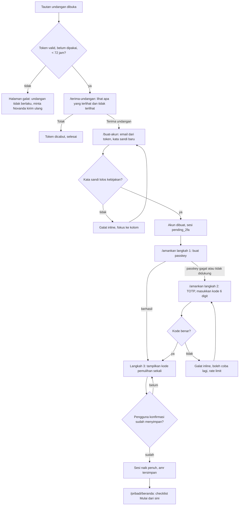
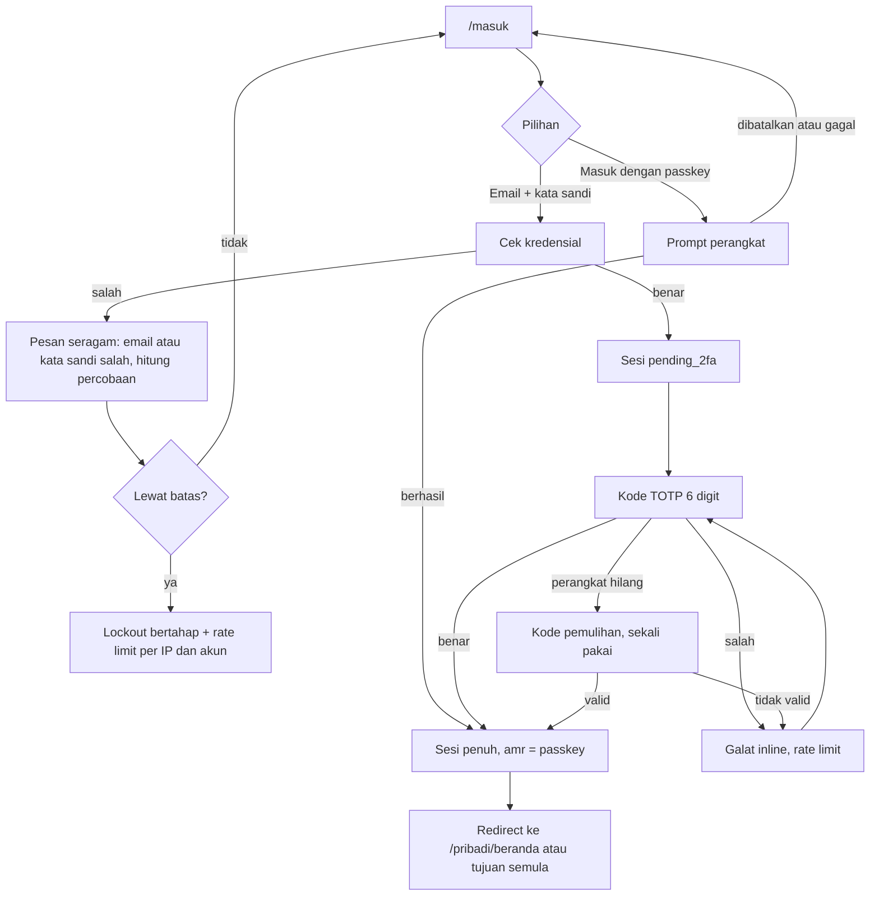
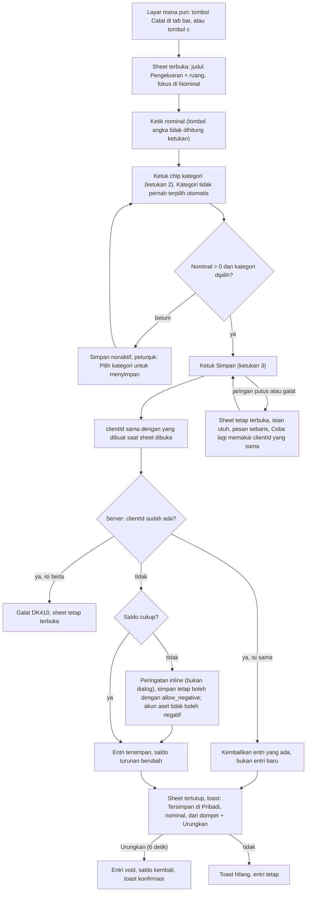
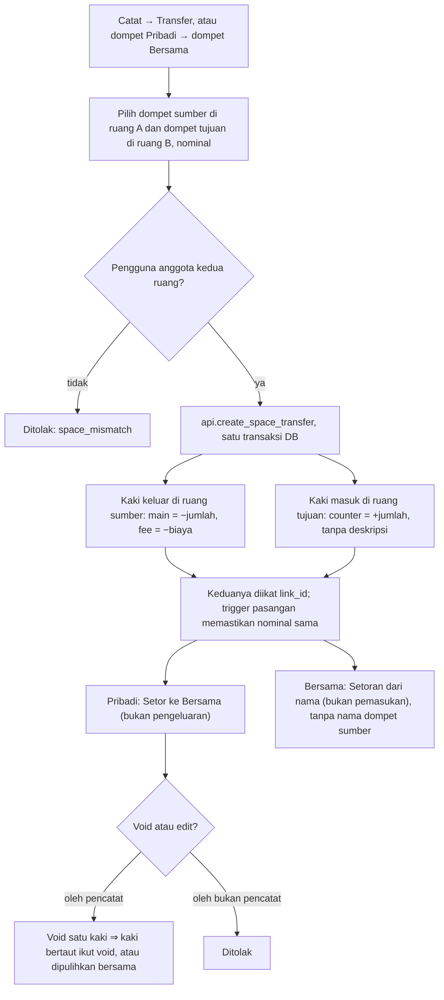
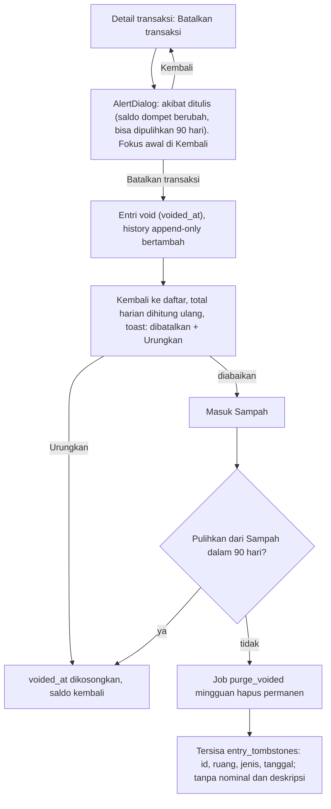
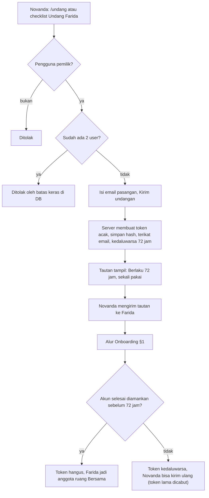

# AFD: diagram alur aplikasi DompetKu v2

Status: draf untuk review tim. Tanggal: 2026-10-31.
Sumber: Spec §5.3, §5.4, §9.1 sampai §9.3; `docs/design/panel-malam/README.md` (layar A1 sampai A4, C1 sampai C5, D1 sampai D4); kode M0a di `apps/web/src/app/` dan `apps/web/src/features/`. Alur auth di M0a adalah tiruan; langkah server dan kode galat di bawah adalah rencana M0b/M1 (rinci di BSD dan TRD).

Rute prototipe: `/masuk`, `/undang`, `/terima-undangan`, `/buat-akun`, `/amankan`, `/[ruang]/{beranda,transaksi,dompet,rencana}` dengan `[ruang]` = `pribadi` atau `bersama`.

## 1. Onboarding Farida (undangan sampai Beranda)

**Keadaan.** `undangan_valid`, `akun_dibuat (pending_2fa)`, `faktor_kuat_aktif`, `pemulihan_dikonfirmasi`, `sesi_penuh`.
**Jalur galat.** Token kedaluwarsa, sudah dipakai, atau salah: respons seragam, tanpa membocorkan alasan rinci. Email di form berasal dari token dan tidak bisa diganti. Sesi `pending_2fa` ditolak oleh `requireUser` untuk semua halaman data. Pengguna ke-3 ditolak oleh batas keras 2 user di DB.
**Catatan.** Prototipe M0a: tiap langkah tiruan, panjang minimal kata sandi 12 (dapat berubah saat kebijakan Better Auth ditetapkan). Novanda sebagai pemilik melewati `/terima-undangan` dan `/buat-akun`; ia mendaftar lewat allowlist `AUTH_ALLOWED_EMAILS` lalu masuk ke `/amankan` (Belum diputuskan: tombol pendaftaran pemilik pertama, ditetapkan di M0b).
**Beranda pertama.** Tidak ada "Rp 0". Checklist: Akun aman, Tambah dompet sehari-hari, Catat satu pengeluaran, Undang Farida (bagi Farida langkah ini tidak ada; Belum diputuskan pengganti langkah ke-4).

## 2. Masuk (passkey atau password+TOTP)

**Aturan.** Faktor kuat wajib: passkey ATAU password+TOTP (Spec §9.2). Respons login dan reset seragam. Reset password mencabut semua sesi dan tidak mematikan 2FA. Kode pemulihan yang dipakai hangus.
**Belum diputuskan.** Alur "lupa kata sandi" (email reset, penyedia email) dan layar Menu → Pengaturan untuk daftar perangkat dan cabut sesi (di Menu tampil "Segera").

## 3. Catat (≤ 3 ketukan, toast + Urungkan, `clientId` idempoten)

**Keadaan.** `idle`, `terisi`, `menyimpan`, `tersimpan`, `galat`. Sheet menyebut ruang tujuan; dompet terbatas pada ruang itu.
**Pindah ruang di sheet.** "Pindah ke Bersama/Pribadi" mempertahankan nominal, mengganti dompet ke operasional terakhir ruang tujuan, mereset kategori, dan membuat `clientId` baru (niat baru).
**Jenis.** Pengeluaran, Pemasukan, Transfer lewat menu di judul sheet. Transfer antar ruang ada di §4 dan baru aktif M1; di prototipe M0a Catat hanya transfer dalam satu ruang.
**Prototipe.** "Menyimpan…" ditunda ke M1 (store sinkron). Toast menampilkan 6 detik, berhenti saat hover atau fokus.
**Kecepatan.** Target median ≤ 8 detik dan ≥ 70% catatan ≤ 3 ketukan (lihat PRD §7).

## 4. Transfer antar ruang (kaki bertaut, void keduanya)

**Aturan (Spec §9.1).** Dua entri `space_transfer` per transfer, satu per ruang. Σ lines = −fee. Catatan untuk Bersama hanya lewat `shared_note` yang diisi eksplisit. Edit dan void hanya oleh pencatat. Arah Bersama ke Pribadi diizinkan untuk anggota mana pun (Spec §7a, tercatat "Diambil oleh nama").
**Jalur galat.** `space_mismatch`, saldo kurang (peringatan seperti §3), `clientId` bentrok (DK410), kaki pasangan hilang (ditolak trigger, tidak boleh terjadi lewat fungsi).
**Prototipe M0a.** Seed demo sudah memuat kaki bertaut (`linkId`, arah out/in); void atau pulihkan satu kaki ikut membalik kaki lainnya. Catat belum menawarkan transfer lintas ruang (Belum diputuskan, mungkin diminta pemilik saat penilaian).

## 5. Batalkan dan urungkan (sampah 90 hari)

**Aturan.** Soft delete; purge setelah 90 hari (keputusan pemilik, Spec §9.1); `entry_history` ikut terhapus bersama entrinya. Untuk `space_transfer`, void dan pulihkan berlaku pada kedua kaki. URL transaksi yang sudah dibatalkan menampilkan "Transaksi ini sudah dibatalkan." (bukan 404).
**Belum diputuskan.** Layar Sampah (belum ada di prototipe; teks akibat menyebut "dari Sampah") dan tempatnya di navigasi. "Ubah" dan "Pindahkan ke ruang lain" di detail masih toast "Segera di M1".

## 6. Undang Farida (token sekali pakai 72 jam, batas 2 user)

**Aturan (Spec §9.2).** Token disimpan sebagai hash, sekali pakai, terikat email. Audit log mencatat undangan dibuat, dipakai, dicabut. Tautan harus diperlakukan seperti kata sandi.
**Belum diputuskan.** Cara pengiriman (Novanda menyalin tautan sendiri atau email lewat penyedia SMTP; penyedia email Belum diputuskan, Spec §8), dan perilaku bila email Farida diketik salah.

## Pertanyaan terbuka

1. Pendaftaran pemilik pertama (bootstrapping akun Novanda) dan layar "lupa kata sandi".
2. Pengganti langkah "Undang Farida" di checklist milik Farida.
3. Layar Sampah dan lokasinya di navigasi.
4. Transfer lintas ruang di Catat: kapan muncul (M1) dan apakah di prototipe M0a ditambah.
5. Cara kirim undangan dan penanganan email salah.
6. Aturan akhir faktor kuat (TOTP wajib di samping passkey atau tidak).
