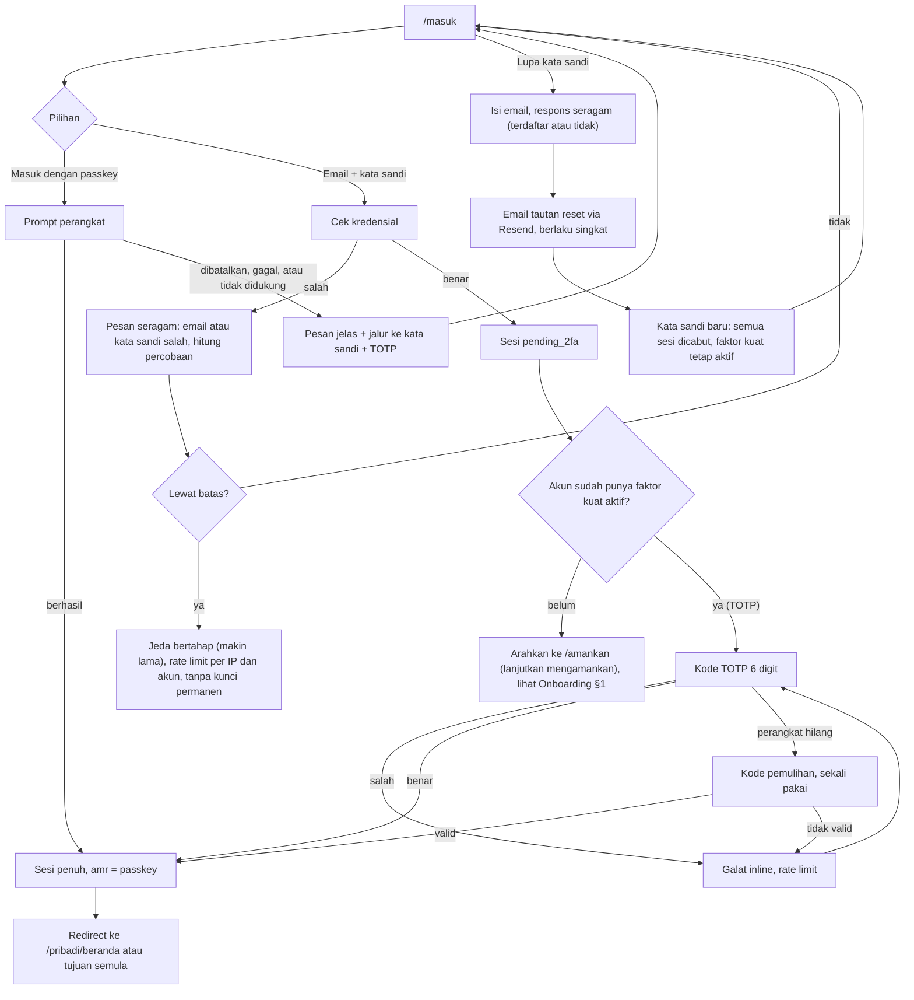
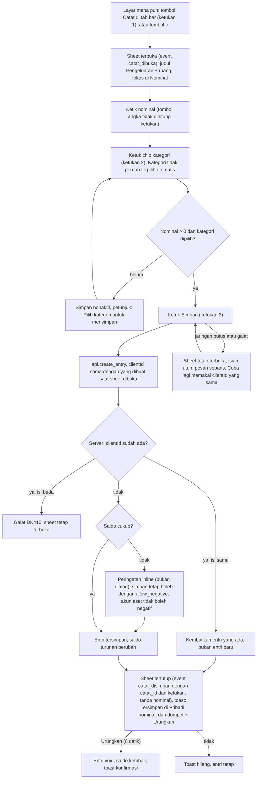
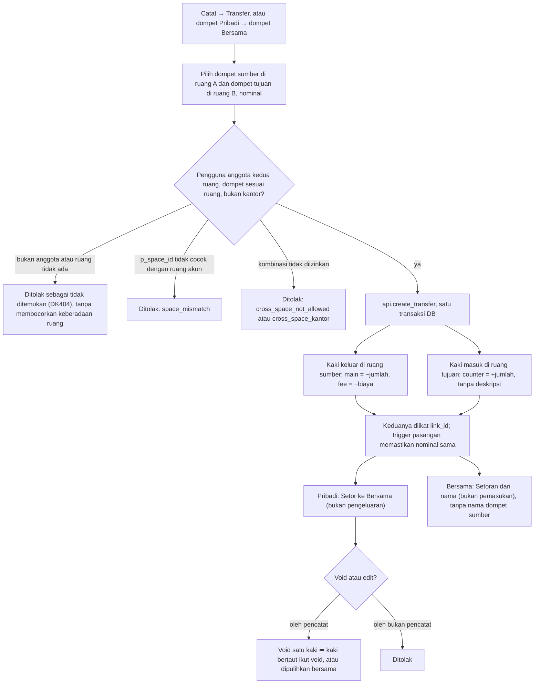
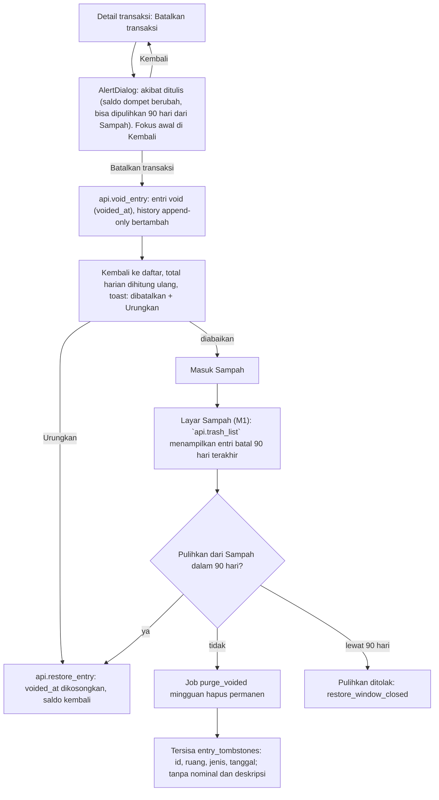
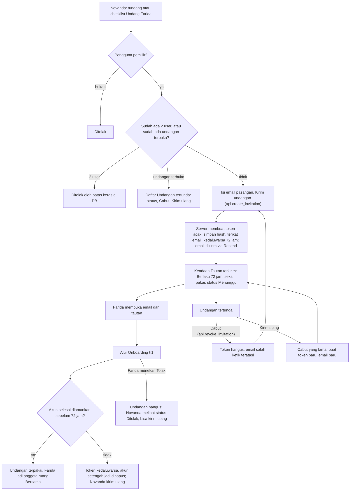
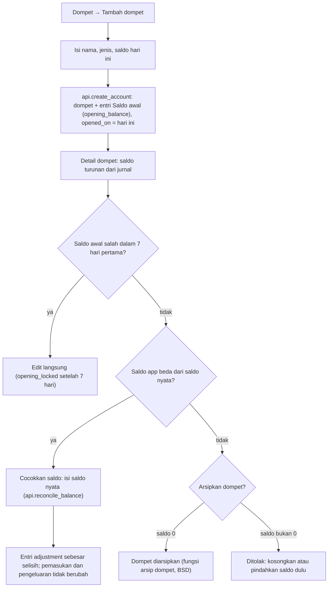
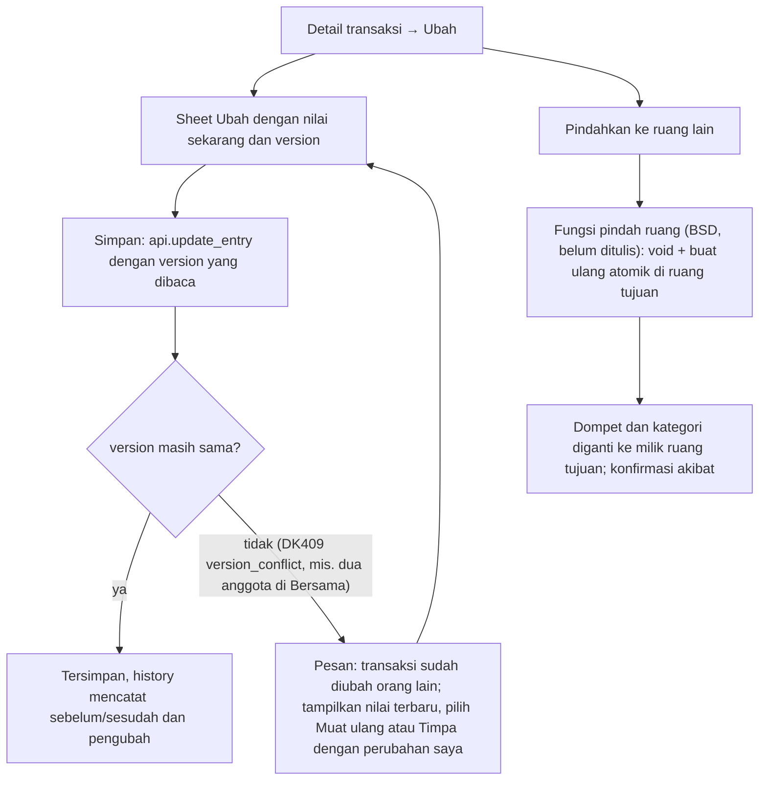
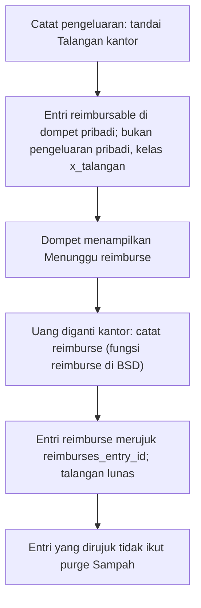
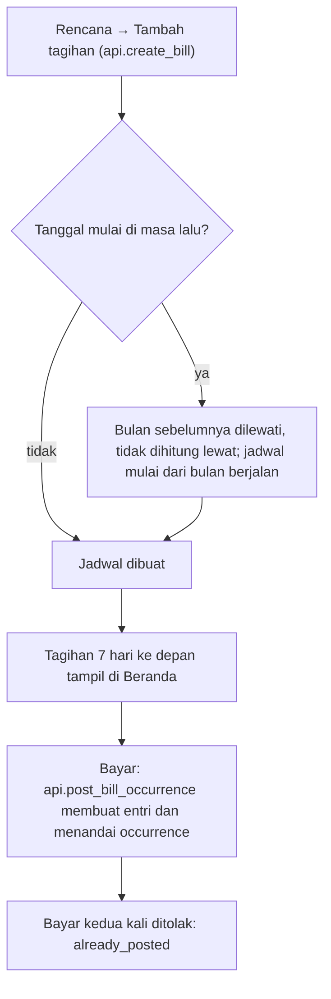

# AFD: diagram alur aplikasi DompetKu v2

Status: draf revisi setelah review tim dan 18 keputusan pemilik (`review/keputusan-pemilik.md`). Tanggal: 2026-10-31.
Sumber: Spec §5.3, §5.4, §9.1 sampai §9.3; `docs/design/panel-malam/README.md` (layar A1 sampai A4, C1 sampai C5, D1 sampai D4); kode M0a di `apps/web/src/app/` dan `apps/web/src/features/`. Alur auth di M0a adalah tiruan; langkah server dan kode galat di bawah adalah rencana M0b/M1 (rinci di BSD dan TRD).

Rute prototipe: `/` (mengalihkan ke `/pribadi/beranda`), `/masuk`, `/undang`, `/terima-undangan`, `/buat-akun`, `/amankan`, `/[ruang]/{beranda,transaksi,dompet,rencana}`, `/[ruang]/transaksi/[id]`, `/[ruang]/dompet/[id]`, dan `/dev/ui` (galeri keadaan, hanya dev), dengan `[ruang]` = `pribadi` atau `bersama`.

Nama fungsi mengikuti `BSD.md` (skema `api.*`). Fungsi undangan dan Sampah: `api.decline_invitation`, `api.revoke_invitation`, `api.resend_invitation`, `api.trash_list`, `api.restore_entry`, `api.purge_entry`.

**Selisih prototipe M0a dan rencana.** Di prototipe, `/masuk` dengan email dan kata sandi langsung menuju `/amankan` (pendaftaran faktor), bukan verifikasi TOTP; semua langkah auth tiruan. Diagram di bawah adalah rencana M0b.

## 0. Aturan lintas alur

- **Faktor kuat wajib (satu aturan, sama di PRD, AFD, IPD):** passkey ATAU kata sandi + TOTP. Kode pemulihan dibuat untuk semua akun, termasuk yang hanya punya passkey. Sesi `pending_2fa` (belum punya faktor kuat aktif atau belum login dengan faktor kedua) hanya boleh membuka `/amankan` atau layar verifikasi, tidak halaman data.
- **Sesi:** idle 7 hari, absolut 30 hari. Gagal login memberi jeda bertahap, tanpa kunci permanen.
- **Penyedia email:** Resend (undangan, lupa kata sandi, alert).

## 1. Onboarding Farida (undangan sampai Beranda)

```mermaid
flowchart TD
  A["Tautan undangan di email dibuka"] --> B{"Token valid: belum terpakai, tidak dicabut, tidak ditolak, < 72 jam?"}
  B -- "tidak" --> B1["Halaman galat seragam: undangan tidak berlaku, minta Novanda kirim ulang"]
  B -- "ya" --> C["/terima-undangan: lihat apa yang terlihat dan tidak terlihat (api.invitation_peek)"]
  C -- "Tolak" --> C1["`api.decline_invitation`: undangan hangus, selesai. Novanda melihat status Ditolak dan bisa kirim ulang"]
  C -- "Terima undangan" --> D["/buat-akun: email dari token, kata sandi baru"]
  D --> D1{"Kata sandi lolos kebijakan?"}
  D1 -- "tidak" --> D2["Galat inline, fokus ke kolom"]
  D2 --> D
  D1 -- "ya" --> E["Akun dibuat, sesi pending_2fa. Undangan BELUM terpakai; akun setengah jadi tidak dihitung kuota 2 user"]
  E --> F["/amankan langkah 1: buat passkey"]
  F -- "passkey gagal, dibatalkan, atau tidak didukung" --> G
  F -- "berhasil" --> H
  G["/amankan langkah 2: TOTP, masukkan kode 6 digit"] --> G1{"Kode benar?"}
  G1 -- "tidak" --> G2["Galat inline, boleh coba lagi, rate limit"]
  G2 --> G
  G1 -- "ya" --> H["Langkah 3: tampilkan kode pemulihan sekali"]
  H --> H1{"Pengguna konfirmasi sudah menyimpan?"}
  H1 -- "belum" --> H
  H1 -- "sudah" --> H2["api.accept_invitation: undangan terpakai, F anggota Bersama, ruang Pribadi dibuat, kuota 2 user terisi"]
  H2 --> I["Sesi naik penuh, amr tersimpan"]
  I --> J["/pribadi/beranda: checklist Mulai dari sini (3 langkah)"]
  E -. "berhenti di sini" .-> K["Login berikutnya: kata sandi lalu sesi pending_2fa tanpa faktor diarahkan ke /amankan (lanjutkan mengamankan)"]
  K --> F
  E -. "lewat 72 jam tanpa selesai" .-> L["Akun setengah jadi dihapus; undangan kedaluwarsa; Novanda kirim ulang"]
```

**Keadaan.** `undangan_valid`, `akun_dibuat (pending_2fa)`, `faktor_kuat_aktif`, `pemulihan_dikonfirmasi`, `undangan_terpakai`, `sesi_penuh`.
**Aturan pemakaian undangan (keputusan pemilik).** Undangan baru terpakai setelah akun diamankan (faktor kuat aktif dan kode pemulihan dikonfirmasi). Titik panggil `api.accept_invitation` mengikuti BSD yang disesuaikan; sebelum itu Novanda masih bisa mencabut atau mengirim ulang.
**Jalur galat.** Token kedaluwarsa, sudah dipakai, dicabut, ditolak, atau salah: respons dan halaman seragam, tanpa membocorkan alasan. Email di form berasal dari token dan tidak bisa diganti. Sesi `pending_2fa` ditolak oleh `requireUser` untuk semua halaman data. Pengguna ke-3 ditolak oleh batas keras 2 user di DB (`user_limit`).
**Catatan.** Prototipe M0a: tiap langkah tiruan, panjang minimal kata sandi 12 (final mengikuti kebijakan Better Auth di BSD/M0b, termasuk penolakan kata sandi bocor atau lemah). Novanda (pemilik) tidak lewat undangan: akunnya lahir dari allowlist `AUTH_ALLOWED_EMAILS` (env), lalu langkah `/amankan` yang sama (§2).
**Beranda pertama.** Tidak ada "Rp 0". Checklist Novanda 4 langkah: Akun aman, Tambah dompet sehari-hari, Catat satu pengeluaran, Undang Farida. Checklist Farida 3 langkah ("1 dari 3 selesai"): Akun aman, Tambah dompet, Catat satu pengeluaran; langkah pengganti tidak ada. Layar ini adalah utang desain (DBD §9).

## 2. Masuk, lupa kata sandi, akun pertama



**Aturan.** Faktor kuat wajib (§0). Respons login dan reset seragam. Reset kata sandi mencabut semua sesi dan tidak mematikan 2FA. Kode pemulihan yang dipakai hangus. Akun yang hanya punya passkey memakai kode pemulihan bila perangkat hilang. Sesi idle 7 hari, absolut 30 hari.
**Akun pertama.** Novanda mendaftar sekali lewat allowlist env (`AUTH_ALLOWED_EMAILS`): email dalam daftar boleh membuat akun pemilik, lalu `/amankan` dan kode pemulihan seperti §1. Email di luar daftar dan bukan dari undangan ditolak.
**Menu → Pengaturan.** Daftar perangkat dan cabut sesi, audit log yang bisa dibaca pemilik (di prototipe Menu menampilkan "Segera"; layar ini utang desain, DBD §9).
**Keadaan galat auth** (kode salah, rate limit, kode pemulihan, passkey dibatalkan, pesan seragam, jeda bertahap) perlu bingkai desain sebelum M0b; lihat DBD §9.

## 3. Catat (jalur tercepat ≤ 3 ketukan, toast + Urungkan, `clientId` idempoten)



**Keadaan.** `idle`, `terisi`, `menyimpan`, `tersimpan`, `galat`. Sheet menyebut ruang tujuan; dompet terbatas pada ruang itu.
**Pindah ruang di sheet.** "Pindah ke Bersama/Pribadi" mempertahankan nominal, mengganti dompet ke operasional terakhir ruang tujuan, mereset kategori, dan membuat `clientId` baru (niat baru).
**Jenis.** Pengeluaran, Pemasukan, Transfer lewat menu di judul sheet. Transfer antar ruang ada di §4 dan baru aktif M1; di prototipe M0a Catat hanya transfer dalam satu ruang.
**Prototipe.** "Menyimpan…" ditunda ke M1 (store sinkron). Toast menampilkan 6 detik, berhenti saat hover atau fokus.
**Aturan hitung ketukan** (sama dengan PRD §7): yang dihitung adalah aksi pointer dari tombol Catat sampai Simpan, jadi jalur tercepat = Catat, kategori, Simpan = 3 ketukan. Tombol angka dan ketikan nominal tidak dihitung. Pintasan `c` menggantikan ketukan tombol Catat dan tidak dihitung. Jalur lebih panjang (chip "Kategori lain…", ganti dompet, ganti tanggal) tetap sah; jumlah ketukan nyata dikirim pada event `catat_disimpan`.
**Kecepatan.** Target median ≤ 8 detik (selisih `catat_dibuka` ke `catat_disimpan` dengan `catat_id` sama) dan ≥ 70% catatan ≤ 3 ketukan (PRD §7). Tombol "Tidak ada pengeluaran hari ini" ada di Beranda dan mencatat hari itu sebagai tercatat (`api.mark_no_spend_day`).
**Galat yang tampil ke pengguna.** `DK410` (clientId bentrok, sheet tetap terbuka); `before_opening` (tanggal sebelum dompet dibuka: pesan dengan tanggal buka dompet, pemilih tanggal dibatasi); `account_archived` (dompet terarsip: pilih dompet lain); `saldo_negatif` (peringatan inline, lihat atas); `DK409 version_conflict` (hanya pada edit, §8); jaringan putus (sheet tetap terbuka, Coba lagi). Jalur pemulihan selalu mempertahankan isian.

## 4. Transfer antar ruang (kaki bertaut, void keduanya)



**Aturan (Spec §9.1).** Dua entri `space_transfer` per transfer, satu per ruang. Σ lines = −fee. Edit dan void hanya oleh pencatat.
**Bersama ke Pribadi (keputusan pemilik).** Diizinkan untuk anggota mana pun (Spec §7a). Keterangan yang diisi pengambil disimpan di sisi Pribadi saja; Bersama hanya menampilkan "Diambil oleh nama", tanpa nama dompet tujuan dan tanpa keterangan. Catatan untuk Bersama hanya lewat `shared_note` yang diisi eksplisit.
**Biaya transfer dari Kas Kantor (keputusan pemilik).** Biaya masuk angka Kantor ("Tidak masuk hitungan pribadi"), bukan pengeluaran pribadi.
**Jalur galat.** `space_mismatch`, `cross_space_not_allowed`, `cross_space_kantor`, saldo kurang (peringatan seperti §3), `clientId` bentrok (DK410), kaki pasangan hilang (`space_transfer_pair_invalid`, ditolak trigger, tidak boleh terjadi lewat fungsi).
**Prototipe M0a.** Seed demo sudah memuat kaki bertaut (`linkId`, arah out/in); void atau pulihkan satu kaki ikut membalik kaki lainnya. Catat belum menawarkan transfer lintas ruang; di M1 menu jenis Transfer menawarkannya (butuh bingkai desain, DBD §9).

## 5. Batalkan, urungkan, dan Sampah (90 hari)



**Aturan.** Soft delete; purge setelah 90 hari (keputusan pemilik, Spec §9.1); `entry_history` ikut terhapus bersama entrinya. Untuk `space_transfer`, void dan pulihkan berlaku pada kedua kaki, dan purge menghapus pasangan berdua. Entri yang dirujuk `reimburses_entry_id` dilewati purge. URL transaksi yang sudah dibatalkan menampilkan "Transaksi ini sudah dibatalkan." dengan aksi Pulihkan (bukan 404; bingkai D5 perlu didesain).
**Layar Sampah di M1 (keputusan pemilik).** Dibangun bersama fungsi baca entri void di BSD; tempatnya di navigasi ditetapkan saat desain (utang desain, DBD §9). Teks dialog "dari Sampah" tetap karena layarnya ada.
**Belum selesai di prototipe.** "Ubah" dan "Pindahkan ke ruang lain" di detail masih toast "Segera di M1" (lihat §8).

## 6. Undang Farida (email, token sekali pakai 72 jam, batas 2 user)



**Aturan (Spec §9.2, keputusan pemilik).** Dikirim lewat email, yang sekaligus memverifikasi alamat Farida. Token disimpan sebagai hash, sekali pakai, terikat email. Satu undangan terbuka per rumah tangga; karena itu Novanda perlu layar Undangan tertunda untuk mencabut atau mengirim ulang bila email salah. Audit log mencatat undangan dibuat, dipakai, dicabut, ditolak. Tautan diperlakukan seperti kata sandi.
**Layar pendukung** (utang desain, DBD §9): keadaan Tautan terkirim, daftar Undangan tertunda, halaman galat undangan dengan salinan yang tidak membocorkan alasan.

## 7. Dompet baru, Cocokkan saldo, arsip (M1)



**Aturan.** Dompet hanya bisa diarsipkan bila saldo 0 (keputusan pemilik). Dompet terarsip tidak muncul di pilihan Catat (`account_archived` bila terpaksa). Tanggal Catat tidak boleh sebelum tanggal buka dompet (`before_opening`). Biaya transfer dari dompet Kantor masuk angka Kantor.

## 8. Ubah transaksi, konflik versi, pindah ruang (M1)



**Aturan.** Edit di Bersama oleh bukan pencatat mengikuti hak setara (Spec §7a) kecuali `space_transfer` (hanya pencatat). Transaksi yang sudah dibatalkan tidak bisa diubah (`entry_voided`).

## 9. Talangan dan reimburse (M1)



**Aturan.** Hanya pengeluaran pribadi yang bisa ditalangi (`reimbursable_personal_expense_only`); dompet Kantor hanya di ruang Pribadi (`kantor_personal_only`). Ikon dan alur "Menunggu reimburse" butuh bingkai desain (DBD §9).

## 10. Tagihan rutin dasar (M2)



**Aturan.** Satu kewajiban satu sumber: tagihan atau anggaran wajib, tidak keduanya (`obligation_double`). Tagihan lanjutan (tanggal 31, trip, deteksi langganan) di M5.

## Pertanyaan terbuka

Ditutup keputusan pemilik 2026-10-31: aturan faktor kuat, pendaftaran pemilik pertama dan lupa kata sandi, cara kirim undangan dan email salah, layar Sampah.

1. Transfer lintas ruang di Catat: tampil di M1; belum ada di prototipe M0a.
2. Letak layar Sampah dalam navigasi (ditetapkan saat desain).
3. Pengganti langkah "Undang Farida" di checklist Farida: diputuskan tidak ada (3 langkah), desain perlu dibuat.
4. `api.move_entry_to_space` dan `api.create_reimbursement` masih berupa daftar di BSD (belum ditulis).
