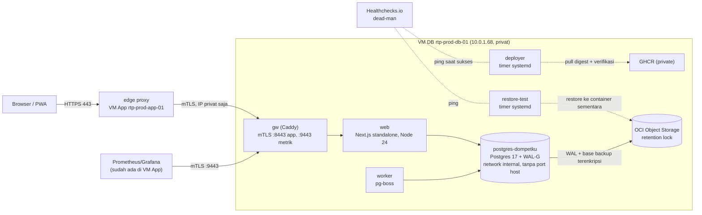
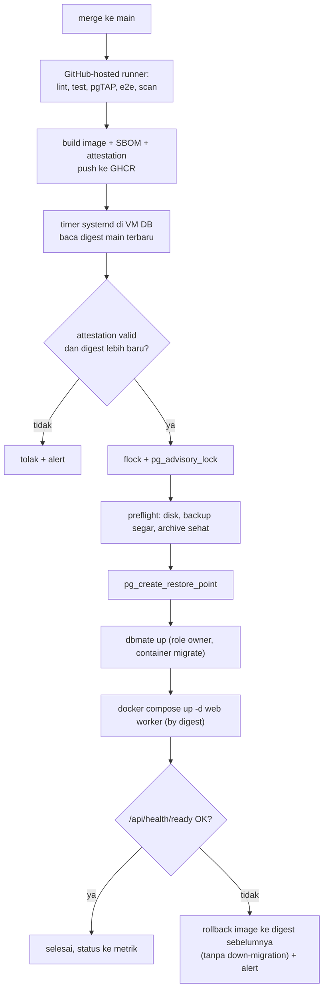

# TRD: Technical Requirements Document DompetKu v2

Status: draf putaran 2 (temuan review backend dan security diterapkan, keputusan pemilik 2026-10-31 masuk), menunggu persetujuan pemilik. Tanggal: 2026-10-31.

Dokumen ini merangkum persyaratan teknis dari bahan yang sudah disetujui. Bila ada pertentangan, urutan yang berlaku:

1. Spec induk `docs/superpowers/specs/2026-10-29-dompetku-v2-design.md` §9 (keputusan tim, mengalahkan §1 sampai §8).
2. ADR di `docs/adr/` dan `docs/m0a-keputusan.md`.
3. Riset tim di `docs/team/round1` dan `docs/team/round2` (usulan, bukan keputusan, kecuali sudah masuk spec §9).

Nilai yang tidak ada di spec atau ADR ditandai **Belum diputuskan**. Nilai yang berasal dari riset tim tetapi belum disahkan ditandai **usulan** beserta sumbernya. Skema database, role, RLS, dan fungsi ada di `docs/product/BSD.md`.

## 1. Ruang lingkup

- Produk: aplikasi keuangan dua orang (Novanda, Farida) dengan ruang Pribadi per orang dan satu ruang Bersama (spec §1, §5.4).
- Bukan SaaS: tanpa pendaftaran terbuka, tanpa billing, batas keras 2 user (spec §2, §9.2).
- Self-hosted di OCI milik pemilik, domain publik `dompet.novandafadly.com` (spec §4.3, §8 usulan nama).
- Tidak ada migrasi data v1; semua ruang mulai kosong (spec §3, §7a).

## 2. Arsitektur

### 2.1 Topologi

Web dan worker berjalan di VM DB, bukan VM App, karena VM App sempit (spec §7a). VM App hanya memegang reverse proxy publik.



### 2.2 Komponen

| Komponen            | Isi                                                                                                                                                                  | Sumber                          |
| ------------------- | -------------------------------------------------------------------------------------------------------------------------------------------------------------------- | ------------------------------- |
| edge proxy (VM App) | Proxy yang sudah ada bila ada, bila tidak Caddy. TLS publik, HSTS, menimpa `X-Forwarded-For`/`X-Forwarded-Proto`/`Host`, membuang `x-middleware-subrequest`.         | spec §5.7, §9.2; security r2 B3 |
| `gw` (Caddy, VM DB) | Satu-satunya port yang dipublikasikan: `10.0.1.68:8443` (app) dan `:9443` (metrik), mTLS, hanya dari IP privat VM App.                                               | spec §9.2                       |
| `web`               | Next.js 16.4.3 `output: 'standalone'`, React 19.3.1, Node 24 LTS. RSC untuk baca, Server Actions untuk tulis. Akses DB hanya dari server lewat `pg` + Kysely.        | ADR 0001; spec §5.1, §9.3       |
| `worker`            | Proses Node terpisah, pg-boss (antrean + cron di Postgres, tanpa Redis).                                                                                             | spec §5.5                       |
| `postgres-dompetku` | Postgres 17 + WAL-G + pgaudit (image dibangun sendiri) dalam compose project `dompetku`, network Docker `internal`, tanpa port host, `scram-sha-256`, limit CPU/RAM. | spec §5.7, §9.2; BSD §12        |
| deployer            | Timer systemd: tarik digest `main` terbaru dari GHCR (token read-only), verifikasi attestation, tolak digest lebih lama, jalankan `/opt/dompetku/bin/deploy`.        | spec §9.2, §9.5                 |
| restore-test        | Timer systemd di host (bukan job pg-boss) untuk uji restore mingguan.                                                                                                | spec §9.2                       |
| OCI Object Storage  | Bucket backup, kunci Customer Secret khusus bucket tanpa izin hapus, retention lock.                                                                                 | spec §5.7, §9.2                 |

### 2.3 Alur baca dan tulis

Setiap request terautentikasi berjalan dalam transaksi pendek `withUser`. `set_config('app.user_id', $1, true)` dijalankan sebelum query apa pun, dan RLS membaca nilai itu (spec §5.1, §9.1).

Tingkat isolasi transaksi tulis wajib **READ COMMITTED** (BSD §3). Penjaga saldo negatif, batas 2 user, dan kewajiban XOR bergantung pada lock eksplisit plus snapshot baru per statement; di REPEATABLE READ dua pengeluaran paralel bisa sama-sama lolos (terbukti di review backend). Penegakan: default role DB, cek di setiap fungsi tulis (`DK500 isolation_not_read_committed`), dan lint yang melarang `SET TRANSACTION ISOLATION` serta opsi `isolationLevel` di `apps/**`.

```mermaid
sequenceDiagram
  autonumber
  participant U as Browser
  participant A as Server Action (web)
  participant DB as Postgres
  U->>A: Simpan (client_id dari sheet, spaceId, input)
  A->>A: requireUser(): tolak sesi pending_2fa / tanpa amr kuat
  A->>A: Zod parse input
  A->>DB: BEGIN; select set_config('app.user_id', uid, true)
  A->>DB: select api.create_entry(p_client_id => ..., ...)
  DB->>DB: SECURITY DEFINER (dompetku_api), RLS, idempotensi, lock akun, cek bentuk
  DB-->>A: jsonb {entry_id, version, replayed, warnings}
  A->>DB: COMMIT
  A-->>U: hasil + toast Urungkan (optimistic UI)
  Note over A,DB: Error DKxxx dipetakan ke pesan Indonesia. 40P01 (deadlock) dan 40001 diulang maks 3x (aman karena idempoten).
```

Baca memakai RSC dengan loader per data, masing-masing satu transaksi `read only` pendek. Cache data Next dilarang untuk data user; halaman berdata memakai `Cache-Control: no-store` (spec §9.2).

### 2.4 Alur deploy



Syarat rollback aman: migrasi maju-saja dengan pola expand/contract, dan job CI `compat-n-1` (image produksi saat ini terhadap skema baru) wajib hijau (spec §5.7, §9.1; round2 backend B1).

## 3. Persyaratan non-fungsional

### 3.1 Performa

| Persyaratan                                                  | Target                                                                                                                 | Sumber / status                                             |
| ------------------------------------------------------------ | ---------------------------------------------------------------------------------------------------------------------- | ----------------------------------------------------------- |
| JS rute muat dingin `/pribadi/beranda`, `/pribadi/transaksi` | ≤ 162 kB gzip (hanya JS rute; prefetch dan muat malas dikecualikan)                                                    | ADR 0002; target 150 kB di M2 dibatalkan pemilik 2026-10-31 |
| Catat cepat                                                  | ≤ 3 ketukan (Catat, chip kategori, Simpan), median waktu catat ≤ 8 detik                                               | spec §1, §9.3                                               |
| Saldo semua akun pada fixture 50k entri per ruang            | p95 ≤ 20 ms; di atas itu baru boleh ada cache saldo (dengan tes rekonsiliasi dan ADR)                                  | usulan round1 backend R7, job CI tidak memblokir            |
| `period_summary`                                             | p95 ≤ 50 ms pada data demo ×10; di atas itu baru boleh tabel agregat                                                   | usulan round1 data-engineer R3                              |
| Daftar transaksi                                             | paginasi kursor 50 baris                                                                                               | v1 DESIGN §10, m0a-keputusan T10                            |
| Latensi server (TTFB, Server Action)                         | **Belum diputuskan**: spec tidak menetapkan angka p95                                                                  | celah, lihat Pertanyaan terbuka                             |
| Web Vitals (persentil 75, HP kelas menengah)                 | LCP < 2,5 s, INP < 200 ms, CLS < 0,1 (ambang "baik" Google)                                                            | keputusan pemilik #16                                       |
| Pengukuran Catat                                             | `product_events` `catat_dibuka`/`catat_disimpan`/`catat_batal` dengan `flow_id`, jumlah ketukan, durasi; tanpa nominal | keputusan pemilik #15; BSD §6                               |

### 3.2 Ketersediaan

- Satu host tanpa HA. Target SLO **Belum diputuskan**; usulan 99,5% per bulan (round1 devops R12).
- Deploy otomatis dengan rollback otomatis ke digest sebelumnya bila health check gagal (spec §9.2).
- Dua endpoint kesehatan tanpa data pribadi: `/api/health/live` (proses hidup) dan `/api/health/ready` (DB bisa di-query, versi migrasi cocok, pg-boss terhubung). Usulan round1 devops §6.
- Dead-man di luar VM App: cek jalur publik tiap 5 menit dan ping Healthchecks.io (usulan round1 devops R10; Healthchecks.io disebut di spec §9.2).
- Limit memori/CPU per container agar tidak mengganggu app lain di VM yang sama (spec §5.7). Angka usulan: total DompetKu ≤ 1,7 vCPU dan ≤ 3,6 GiB di VM DB (round1 devops R4), **Belum diputuskan**.

### 3.3 Backup, RPO, RTO

| Butir                           | Nilai                                                                                                                                       | Sumber                                     |
| ------------------------------- | ------------------------------------------------------------------------------------------------------------------------------------------- | ------------------------------------------ |
| RPO                             | ≤ 5 menit                                                                                                                                   | spec §5.7, §9.2                            |
| RTO                             | ≤ 1 jam; ≤ 3 jam bila VM DB hilang, sampai provisioning dilatih                                                                             | spec §9.2                                  |
| Mekanisme harian                | WAL-G: base backup harian + WAL archiving kontinu, `archive_timeout=300`, prefix `daily/`                                                   | spec §5.7, §9.2                            |
| Mekanisme bulanan               | `pg_dump -Fc` terenkripsi tiap tanggal 1 ke prefix `monthly/` (sekaligus jalur kedua independen dari WAL-G)                                 | review security; round1 devops R8          |
| Enkripsi                        | sisi klien (libsodium WAL-G, `age` untuk dump bulanan); kunci di file secret VM, salinan escrow di password manager pemilik                 | spec §7a, §9.2; review security            |
| Penyimpanan                     | OCI Object Storage; kredensial VM hanya boleh tulis dan baca (tanpa `OBJECT_DELETE`), bucket dengan retention rule terkunci                 | spec §9.2                                  |
| Retensi                         | `daily/` 30 hari, `monthly/` 12 bulan, lewat lifecycle policy OCI per prefix (bukan `wal-g delete`)                                         | spec §5.7; review security                 |
| Uji restore                     | mingguan, timer host, restore ke container sementara + pgTAP rekonsiliasi; gagal = alert; dead-man Healthchecks.io                          | spec §5.7, §9.2                            |
| Latihan PITR                    | bulanan, memakai kunci dari salinan escrow (membuktikan escrow cocok), durasi dicatat sebagai bukti RTO; ditambah restore satu dump bulanan | spec §9.2; review security                 |
| Sebelum migrasi                 | `pg_create_restore_point`                                                                                                                   | round2 backend B1                          |
| Jam base backup dan uji restore | usulan 02:15 WIB harian dan Minggu 03:30 WIB                                                                                                | round1 devops R8, R9; **Belum diputuskan** |

Rancangan retensi dengan kredensial tanpa izin hapus (review security, Penting): `wal-g delete` butuh izin hapus dan bertentangan dengan retention lock, jadi tidak dipakai. Objek kedaluwarsa dihapus lifecycle policy OCI (layanan Object Storage, bukan kredensial VM): `daily/` dihapus pada umur 35 hari, `monthly/` pada 13 bulan. Retention rule terkunci 31 hari untuk seluruh bucket, sehingga kredensial VM yang bocor tidak bisa menghapus atau menimpa backup sebulan terakhir. Base backup harian tidak butuh WAL yang lebih tua dari dirinya, jadi menghapus objek per umur menyisakan jendela PITR sekitar 30 hari; di tepi 35 hari satu base backup bisa terhapus sebagian, dan backup itu memang sudah di luar jendela. `WALG_PREVENT_WAL_OVERWRITE=true`: unggah ulang segmen WAL yang sama dianggap sukses, segmen berbeda dengan nama sama gagal (tidak menimpa). Uji wajib M0b: unggah ulang segmen WAL, coba hapus objek dengan kredensial VM (harus gagal), restore dari dump bulanan, dan `wal-g backup-list` setelah lifecycle berjalan.

Data entri yang dipurge (setelah 90 hari atau dari Sampah) masih ada di backup sampai 12 bulan. UI wajib menyebut hal ini (round2 backend A9).

### 3.4 Keamanan

**Autentikasi (Better Auth, tabel di skema `auth`)**

- Faktor kuat wajib: passkey ATAU password + TOTP (spec §9.2, keputusan pemilik #1; mengalahkan §5.3). Ditegakkan di `requireUser`/`withUser`, bukan di middleware. `requireUser` membaca `amr` dari baris sesi di DB, bukan dari cookie cache.
- Keadaan sesi (field `amr`, diisi hook; BSD §5):
  - `passkey`, `password+totp`: sesi penuh.
  - `password` = **enrolling**: sesudah `/buat-akun` atau masuk dengan kata sandi sebelum faktor kuat terdaftar. Hanya boleh `/amankan`. Farida yang berhenti di tengah jalan masuk lagi dengan kata sandi dan diarahkan ke `/amankan`.
  - `recovery`: masuk dengan kode pemulihan. Hanya boleh `/amankan` untuk mendaftarkan faktor baru; semua sesi lain dicabut, audit `recovery_code_used`, email pemberitahuan ke pemilik akun.
  - Sesi `pending_2fa` (kata sandi benar, TOTP belum) ditolak.
- Kode pemulihan untuk semua akun, termasuk yang hanya passkey (keputusan pemilik #1): tabel sendiri `auth.recovery_codes`, 10 kode, hash argon2id, sekali pakai. Kode cadangan plugin two-factor tidak dipakai (terikat TOTP, disimpan terenkripsi, bukan di-hash). Dibuat di `/amankan` sebelum akun dianggap aman; bisa dibuat ulang lewat step-up.
- Tambah/hapus faktor dan buat ulang kode pemulihan wajib step-up (≤ 10 menit); faktor kuat terakhir tidak bisa dihapus (round2 security B5).
- Akun pertama: email Novanda di env `AUTH_OWNER_EMAIL`, disalin runbook ke `app.settings.owner_email`; DB menolak pendaftaran lain selama rumah tangga belum ada (keputusan pemilik #5, BSD §9.3).
- Undangan pasangan dikirim lewat email (Resend) ke alamat undangan, sehingga sekaligus memverifikasi email (keputusan pemilik #2). Token 256-bit, di DB hanya hash SHA-256, sekali pakai, kedaluwarsa 72 jam. Undangan baru terpakai setelah akun diamankan; Farida bisa menolak (undangan hangus); Novanda bisa mencabut dan mengirim ulang (email boleh dikoreksi); akun setengah jadi dihapus setelah 72 jam dan tidak memakan kuota 2 user (keputusan pemilik #3). Detail di BSD §9.3. Rute `/terima-undangan` diberi rate limit per IP.
- Lupa kata sandi lewat email (Resend). Reset mencabut semua sesi dan tidak mematikan 2FA (spec §9.2).
- Respons login dan reset seragam (tidak membocorkan apakah email terdaftar). Rate limit per IP + per akun dengan penyimpanan di DB.
- Gagal kata sandi berulang = **jeda bertahap tanpa kunci permanen** (keputusan pemilik #4): 5 gagal jeda 1 menit, 10 gagal 15 menit, 20 gagal 1 jam (berulang). Jeda hanya untuk jalur kata sandi; passkey dan kode pemulihan tetap bisa dipakai, sehingga penyerang yang tahu email tidak bisa mengunci pemilik. Email pemberitahuan saat jeda 1 jam pertama.
- Sesi: idle 7 hari, absolut 30 hari (keputusan pemilik #4). Cookie `__Host-` dengan `HttpOnly; Secure; SameSite=Lax; Path=/` (spec §5.3).
- Opsi Better Auth yang wajib (nama diverifikasi pada versi terpatok di M0b): `emailAndPassword.revokeSessionsOnPasswordReset: true` (default mati), `minPasswordLength: 12`, `session.cookieCache` mati (agar pencabutan sesi langsung berlaku), `session.expiresIn` 30 hari dengan cek idle 7 hari dari `updatedAt`, `advanced.ipAddress.ipAddressHeaders: ['x-forwarded-for']` saja, `generateId` UUID.
- IP klien: edge proxy menimpa `X-Forwarded-For` dengan IP koneksi, `gw` meneruskan nilai itu apa adanya, web hanya membaca header itu (satu nilai) dan mengabaikan header forward lain. Tes Playwright keamanan mengirim XFF palsu dan memastikan rate limit tetap memakai IP edge.
- ID user Better Auth bertipe UUID, kolom `uuid` di file migrasi (BSD §5).
- Rahasia TOTP terenkripsi dengan `BETTER_AUTH_SECRET`; `dompetku_worker` tanpa akses ke skema `auth` (round2 security §2.7).

**Aplikasi dan header**

- Server Actions diperlakukan sebagai endpoint publik: `requireUser()`, Zod, lalu `withUser`. Origin check sendiri untuk `/api/*` (spec §9.2).
- CSP lengkap (spec §5.7; round1 security R7; review security): `default-src 'self'; script-src 'nonce-…' 'strict-dynamic'; style-src 'self' 'nonce-…'; object-src 'none'; base-uri 'none'; form-action 'self'; frame-ancestors 'none'; connect-src 'self'; worker-src 'self'; img-src 'self' data:`. Style inline Next/font memakai nonce yang sama. Mode report-only satu minggu di M0b, lalu ditegakkan. Ditambah HSTS, Referrer-Policy, Permissions-Policy.
- `Cache-Control: no-store` untuk halaman berdata; cache data Next dilarang untuk data user (spec §9.2).
- Ruang aktif di URL (`/pribadi/...`, `/bersama/...`); action menerima `spaceId` eksplisit sebagai selektor, bukan izin. DB menurunkan ruang dari akun dan menolak bila tidak cocok (spec §9.2; round2 backend C2).
- Header forward hanya dipercaya dari `gw` (spec §9.2).
- Lint melarang `SET` sesi, `set_config(..., false)`, `SET TRANSACTION ISOLATION`, `sql.raw`, `current_date`, dan `dangerouslySetInnerHTML` (spec §9.1; round1 security R5, R7). Berlaku untuk web dan worker.

**Database**: lima role spec §9.1 (`dompetku_owner`, `dompetku_api`, `dompetku_web`, `dompetku_worker`, `dompetku_auditor`) ditambah `dompetku_monitor` untuk `postgres_exporter` (usulan, BSD §15), `FORCE ROW LEVEL SECURITY`, `REVOKE EXECUTE ... FROM PUBLIC`, daftar tertutup fungsi DEFINER. Detail di BSD §3 dan §11.

**Secrets**

- Per file di VM (`chmod 600`) dan GitHub Environments; tidak ada di repo; `.env.example` tanpa nilai (spec §5.7, §9.2). Security mengusulkan `0400` per service (round2 security §2.5), **Belum diputuskan**.
- Validasi Zod saat start; container gagal jalan bila secret hilang (usulan round1 security R10).
- Rotasi tahunan dan saat insiden untuk secret DB, GHCR, Healthchecks, Resend (usulan round1 security R10). Pengecualian: `BETTER_AUTH_SECRET` mengenkripsi rahasia TOTP, jadi hanya dirotasi saat insiden, dengan skrip enkripsi ulang yang diuji lebih dulu (tanpa itu 2FA kedua akun mati).
- Kunci enkripsi backup ada di file secret VM (dibutuhkan WAL-G dan uji restore); password manager pemilik menyimpan salinan escrow yang dipakai latihan PITR bulanan.

**Audit log** append-only untuk login, 2FA, kode pemulihan, ekspor, undangan, sesi dicabut, pindah ruang, akses DB manual, purge, deploy (spec §9.2, §9.5). Retensi usulan 1 tahun (round1 security R12). Web dan worker hanya menulis lewat `audit.log()`, yang mengambil `user_id` dari konteks request; nama event dan kunci `meta` daftar tertutup, nilai skalar, maksimal 1 kB; UPDATE, DELETE, TRUNCATE ditolak di luar fungsi purge. Detail di BSD §6, §7, §10.

**Akses DB manual** (spec §9.5): `log_connections`/`log_disconnections` dan `pgaudit` untuk role `postgres` dan `dompetku_owner`, log Postgres dikirim ke luar VM DB; akses hanya lewat skrip host `dompetku-psql` yang menulis `audit.events` `db_manual_access` dan mengirim alert; koneksi admin tanpa event itu = alert anomali. Detail di BSD §12.

**Rantai pasok**: gitleaks, Semgrep OSS, osv-scanner, Trivy, actionlint + zizmor; Actions dipatok SHA; `pnpm` `minimumReleaseAge` 3 hari; Renovate; patch critical ≤ 48 jam (spec §9.2; ADR 0001).

**Host**: `unattended-upgrades`, SSH key-only, MFA di GitHub dan OCI (sudah aktif, spec §9.5), `chrony` untuk TOTP (usulan round1 security R4).

### 3.5 Privasi antar ruang

Anti-tujuan: data Pribadi pasangan terlihat lewat jalur apa pun (laporan, ekspor, AI, log) (spec §2).

- RLS per tabel: baris terlihat hanya bila `app.current_user_id()` anggota `space_id`-nya. Ruang Pribadi hanya beranggota pemiliknya (spec §5.4).
- Transfer antar ruang = dua entri `space_transfer` terikat `link_id`. Deskripsi hanya di kaki ruang Pribadi, ke arah mana pun (keputusan pemilik #9); catatan ke Bersama hanya lewat `shared_note` eksplisit; ruang tujuan tidak melihat nama dompet sumber (spec §9.1). Ditegakkan oleh CHECK di DB (BSD §6).
- "Tidak ada" dan "bukan milikmu" memakai kode yang sama, `DK404` (round2 security A1).
- Fungsi baca dan view = `SECURITY INVOKER`, sehingga laporan, ekspor, dan AI ikut RLS (spec §9.1).
- Log tanpa nominal, deskripsi, atau email; payload job hanya id; metrik tanpa label ber-PII (spec §5.7, §9.2).
- `product_events` tanpa nominal/deskripsi; nama event daftar tertutup (spec §9.3; BSD §6).
- AI (M6): hanya agregat ruang aktif (round1 security R9).
- Admin server bisa melihat data (diterima pemilik, spec §9.5); akses DB manual tercatat (§3.4). Halaman onboarding Farida menyatakan hal ini (round2 PM §2.1, usulan).

### 3.6 Waktu dan tanggal

- Semua tanggal kalender = WIB (`Asia/Jakarta`). Server Postgres `timezone=UTC`; fungsi memakai `app.today()`/`app.now()` (BSD §4).
- Override jam hanya di env dev/test (spec §9.1).
- Driver `pg`: `date` (OID 1082) jadi string `YYYY-MM-DD`, `int8` jadi `number` dengan assert `Number.isSafeInteger`, `numeric` jadi string (spec §9.1; round2 backend A7).
- Klien memakai `todayWIB()` di `packages/domain`.

### 3.7 Observabilitas

- Log: pino JSON dengan `redact`, `request_id` dari web sampai DB. Postgres: `log_parameter_max_length=0`, `log_parameter_max_length_on_error=0`, `auto_explain` mati, `log_connections`, pgaudit (spec §5.7; round2 backend §2.3; BSD §12). Log Postgres dikirim ke luar VM DB (tujuan **Belum diputuskan**: Loki di VM App atau penyedia log eksternal).
- Metrik: `postgres_exporter` + metrik app ke Prometheus/Grafana yang sudah ada di VM App lewat `gw:9443` (spec §5.7, §9.2). Label rute ter-template (usulan round1 devops §6).
- Alert ke email pemilik (spec §7a): app down, backup gagal, job gagal, disk > 80%, error rate (spec §5.7); anomali audit (spec §9.2). Usulan tambahan: umur arsip WAL > 15 menit, `pg_wal` > 2 GiB, sertifikat mTLS < 30 hari (round1 devops §3).
- `dq_reconcile` 01:00 WIB, 10 cek, alert tanpa nominal (spec §9.1). BSD §10 mengimplementasikan 6 cek pertama.
- Error tracking: GlitchTip atau log + alert, **Belum diputuskan** (spec §8, keputusan builder).

### 3.8 Job terjadwal

| Job                                                   | Jadwal (WIB)          | Tempat     | Sumber                                 |
| ----------------------------------------------------- | --------------------- | ---------- | -------------------------------------- |
| `recurring_materialize` (`jobs.materialize_bills`)    | 00:05                 | worker     | spec §5.5                              |
| `net_worth_snapshot` (untuk H−1, plus hari kotor)     | 00:10                 | worker     | spec §9.1 (menggantikan 23:55 di §5.5) |
| `dq_reconcile`                                        | 01:00                 | worker     | spec §9.1                              |
| `purge_voided`                                        | mingguan              | worker     | spec §5.5                              |
| `purge_unfinished_users` (akun tanpa profil > 72 jam) | harian 01:30          | worker     | keputusan pemilik #3; BSD §10          |
| `purge_idempotency` (kunci > 30 hari)                 | **Belum diputuskan**  | worker     | round2 backend A6                      |
| `purge_audit` (> 1 tahun)                             | **Belum diputuskan**  | worker     | round1 security R12                    |
| dump bulanan `pg_dump` terenkripsi                    | tanggal 1, 02:45      | timer host | §3.3                                   |
| uji restore (`backup_verify`)                         | mingguan              | timer host | spec §9.2                              |
| `price_refresh`                                       | 16:30 hari bursa (M4) | worker     | spec §5.5                              |

Semua job idempoten, status di `jobs.job_runs`, gagal = alert (spec §5.5).

## 4. Strategi pengujian

| Lapisan        | Alat                                                              | Cakupan wajib                                                                                                                                                                    |
| -------------- | ----------------------------------------------------------------- | -------------------------------------------------------------------------------------------------------------------------------------------------------------------------------- |
| Unit           | Vitest + fast-check                                               | `packages/domain` (uang, tanggal WIB), parser nominal "35rb/35k/1,5jt", peta error DK, selector                                                                                  |
| Komponen       | Vitest + Testing Library + happy-dom                              | MoneyInput, sheet Catat (client_id tetap saat retry), combobox keyboard                                                                                                          |
| Database       | pgTAP + `pg_prove`, dijalankan sebagai role app (bukan superuser) | daftar lengkap di BSD §13: katalog, isolasi dua user × tabel × operasi, bentuk lines, pasangan `space_transfer`, idempotensi, versi, kewajiban XOR, purge                        |
| Integrasi DB   | Vitest dengan dua koneksi                                         | konkurensi: kunci idempotensi paralel, DK409, transfer A→B ∥ B→A, arsip ∥ catat, dua pengeluaran paralel (saldo), pendaftaran paralel (batas user); pgTAP tidak bisa menguji ini |
| Properti SQL   | pgTAP `setseed` + 1.000 operasi acak                              | saldo view = Σ ulang, transfer Σ = −fee, pasangan konsisten, version = jumlah history                                                                                            |
| Golden numbers | fixture kecil + `golden.json` dihitung manual                     | laporan M2 termasuk fee, kantor, talangan, `space_transfer`                                                                                                                      |
| E2E            | Playwright desktop + mobile                                       | alur utama, budget JS 162 kB, Web Vitals (LCP, INP, CLS), keamanan (header, CSP, origin, sesi, XFF palsu), smoke pasca-deploy                                                    |
| Aksesibilitas  | `@axe-core/playwright`                                            | pelanggaran serious/critical = 0 (m0a-keputusan T11)                                                                                                                             |
| Restore        | timer host mingguan                                               | restore + rekonsiliasi lulus, selisih commit terakhir ≤ RPO                                                                                                                      |

Saat ini (M0a) ada 215 tes e2e dan unit di `packages/domain`, `packages/demo-data`, `apps/web`.

## 5. Gerbang CI

Sudah ada di `.github/workflows/ci.yml`: lint, format, typecheck, unit, build, e2e Playwright, gitleaks, osv-scanner, actionlint; Actions dipatok SHA; `permissions` minimal.

Wajib ditambahkan di M0b (spec §5.7, §9.1, §9.2):

1. Postgres 17 service, `dbmate up`, pgTAP via `pg_prove`.
2. `kysely-codegen` dan diff `schema.sql`; build gagal bila berbeda.
3. `compat-n-1`: image produksi saat ini terhadap migrasi baru + smoke.
4. Semgrep OSS, Trivy, zizmor.
5. Build image, SBOM, attestation, push GHCR hanya dari `main`.
6. Lint larangan: `SET` sesi, `set_config(..., false)`, `SET TRANSACTION ISOLATION`/`isolationLevel`, `sql.raw`, `current_date`/`localtimestamp`, DML langsung ke `app.*` dari `apps/**`.
7. CODEOWNERS untuk `db/migrations/`, `.github/`, `infra/` (round2 security B1).

Gerbang lokal sebelum push (CLAUDE.md): `pnpm lint && pnpm typecheck && pnpm test && pnpm format:check`, `pnpm build`, e2e.

## 6. Konflik dan celah terhadap spec

| #   | Hal                                                                               | Penanganan di TRD                                                              |
| --- | --------------------------------------------------------------------------------- | ------------------------------------------------------------------------------ |
| 1   | §5.3 menulis TOTP wajib untuk kedua akun; §9.2 menulis passkey ATAU password+TOTP | Mengikuti §9.2; dikonfirmasi pemilik (keputusan #1)                            |
| 2   | §5.2 tiga role (`dompetku_app`, `dompetku_readonly`)                              | Digantikan lima role §9.1                                                      |
| 3   | §5.7 port Postgres 5437 dan TLS app→DB                                            | Digantikan §9.2: tanpa port host; mTLS di hop proxy→`gw`                       |
| 4   | §5.5 `backup_verify` di pg-boss, snapshot 23:55                                   | Digantikan §9.2 (timer host) dan §9.1 (00:10 untuk H−1)                        |
| 5   | §5.7 CD lewat SSH, §7a self-hosted runner                                         | Digantikan deployer pull-based §9.2 (disetujui §9.5)                           |
| 6   | Target latensi server                                                             | Tidak ada di spec; ditandai Belum diputuskan                                   |
| 7   | §5.3 allowlist `AUTH_ALLOWED_EMAILS`, akun pemilik lewat CLI                      | Diganti `AUTH_OWNER_EMAIL` (hanya pemilik) + undangan email (keputusan #2, #5) |

## 7. Pertanyaan terbuka

Terjawab pemilik 2026-10-31: faktor kuat (#1), target Web Vitals (#16), durasi sesi dan jeda login (#4), penyedia email Resend (#5).

1. Target latensi p95 untuk TTFB halaman dan Server Action. Usul: ukur dulu di M1 dengan data nyata, lalu tetapkan.
2. SLO ketersediaan: terima 99,5% per bulan (usulan devops)?
3. Timeout per role: round2 backend mengusulkan `statement_timeout=5s`, `lock_timeout=3s`, `idle_in_transaction_session_timeout=15s` untuk web; round1 security mengusulkan 15 s dan 30 s. BSD memakai angka backend; worker 60 s.
4. Izin file secret: `chmod 600` (spec) atau `0400` per service (security)?
5. Error tracking: GlitchTip atau log + alert?
6. Akun Healthchecks.io, dan tujuan log Postgres di luar VM DB (Loki di VM App atau penyedia eksternal).
7. Jam base backup harian, dump bulanan, dan uji restore mingguan.
8. Anggaran sumber daya container di VM DB (usulan ≤ 1,7 vCPU, ≤ 3,6 GiB).
9. Approval manual per deploy di GitHub Environment `production`, atau otomatis setelah CI hijau?
10. Hasil `uname -m` kedua VM (spec §9.5 butir 1) untuk build image satu arsitektur.

## 8. Catatan review (putaran 2)

Semua temuan Penting dan Minor review backend dan security pada TRD diterapkan: isolasi transaksi (§2.3), retensi backup vs WAL-G dan kredensial tanpa izin hapus (§3.3), lokasi kunci backup, kode pemulihan untuk akun passkey, `amr` untuk kode pemulihan dan keadaan enrolling, jeda bertahap tanpa kunci permanen, opsi Better Auth, header IP, CSP lengkap, rotasi `BETTER_AUTH_SECRET`, akses DB manual (§3.4), rujukan bagian BSD, dan jumlah role. Tidak ada yang ditolak.
